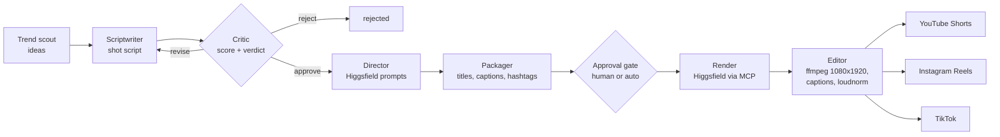

# video-workflow

An automation pipeline for short-form video: **LLM agents write the content, Higgsfield renders
it (through MCP), and the finished vertical videos are published to YouTube Shorts, Instagram
Reels and TikTok.**

- **Any LLM**: Claude, ChatGPT/GPT (OpenAI), Gemini, any OpenAI-compatible endpoint
  (OpenRouter, Groq, local Ollama...), or the Claude Code / Codex / Gemini **CLIs**, so it can
  run on a subscription instead of API keys. Each task has its own fallback chain.
- **Higgsfield through MCP**: either Claude Code renders the shots with the Higgsfield MCP
  connector (`handoff` mode, works today), or the pipeline calls the MCP server itself
  (`higgsfield_mcp` mode, fully headless).
- **Publishing**: YouTube Data API, Instagram Graph API and TikTok Content Posting API,
  with conservative defaults (private / draft) and AI-content disclosure on.
- **Quality gates**: a critic agent from a different model family reviews every script,
  sends it back for revision, and a human approval gate sits before any credits are spent.

## How it works



Every item moves through stages: `idea → reviewed → approved → (awaiting_render) → rendered →
edited → published` (or `rejected` / `failed`). Each step is saved to SQLite, so the pipeline
can stop at any gate and resume later. Details are in [docs/ARCHITECTURE.md](docs/ARCHITECTURE.md).

## Quick start

```bash
# Needs Python 3.11+ and ffmpeg
uv venv && . .venv/bin/activate
uv pip install -e ".[all,dev]"

vw init        # creates config/channel.yaml (your channel brief) and .env (your keys)
vw doctor      # shows which LLMs, renderer and platforms are configured

# Free dry run: real LLM content, placeholder video clips, nothing published
vw run --ideas 2 --until edited --generator mock
vw list
```

The normal loop with real rendering:

```bash
vw run --ideas 3          # pitch, script, critique, package -> stops at "reviewed"
vw list                   # read the scripts: vw show <id>
vw approve <id>           # human gate
vw run                    # renders (or hands off to Claude Code), edits, publishes
```

### Rendering with Higgsfield inside Claude Code (`handoff`, the default)

1. Open this repo in Claude Code. `.mcp.json` registers the Higgsfield MCP server; run `/mcp`
   once to sign in to your Higgsfield account.
2. `vw run` parks approved items in `awaiting_render` and writes a render request with every
   shot prompt.
3. Ask Claude: *"render the pending videos"*. The `higgsfield-render` skill checks the credit
   cost, generates all shots in one batch, and registers the clips with `vw clips add`.
4. `vw run` again to edit and publish.

For unattended runs, set `video.generator: higgsfield_mcp` and `HIGGSFIELD_MCP_TOKEN`. The
pipeline then does the same calls itself, with a credit budget guard (`max_credits_per_video`).
See [docs/HIGGSFIELD.md](docs/HIGGSFIELD.md).

## Choosing models

`config/channel.yaml` maps each task to an ordered list of `provider:model` candidates:

```yaml
llm:
  routes:
    scripting: ["anthropic:claude-opus-5-5", "openai:gpt-5.5", "gemini:gemini-3.1-pro-preview"]
    review:    ["openai:gpt-5.5", "anthropic:claude-opus-5-5"]   # cross-model critique
    packaging: ["cli:codex", "openrouter:meta-llama/llama-4-maverick"]
```

Providers: `anthropic`, `openai`, `gemini`, `cli` (`cli:claude`, `cli:codex`, `cli:gemini`),
plus any name you declare under `llm.compat_providers`. A provider with no key is skipped and
an error falls through to the next candidate.

## Commands

| Command | What it does |
|---|---|
| `vw init` / `vw doctor` | Create config files / check what is configured |
| `vw ideas -n 5 -s "black holes"` | Pitch ideas (optionally seeded with trends) |
| `vw develop <id>` | Script → critique → revise → direct → package |
| `vw approve <id>` / `vw reject <id>` | Human gate |
| `vw render <id> [-g mock\|handoff\|higgsfield_mcp]` | Render shots |
| `vw render-request <id>` / `vw clips add <id> <shot> <url\|file>` | Handoff rendering |
| `vw edit <id> [--voiceover file]` | Build the final 1080x1920 cut with captions |
| `vw publish <id> [-p youtube -p tiktok]` | Publish (retries only the failed platforms) |
| `vw run [--ideas N] [--until stage]` | Autopilot as far as the gates allow |
| `vw list` / `vw show <id>` | Inspect items |
| `vw auth-youtube` | One-time OAuth to get a YouTube refresh token |

## Repository layout

```
src/video_workflow/
  agents/        trend scout, scriptwriter, critic, director, packager (+ prompts/*.md)
  llm/           provider-neutral LLM layer + router with fallbacks
  video/         renderers (handoff, higgsfield_mcp, mock) and the ffmpeg editor
  publishers/    youtube.py, instagram.py, tiktok.py
  pipeline.py    the stage machine        cli.py   the `vw` command
config/          channel.example.yaml — the brand bible every agent reads
.claude/skills/  higgsfield-render — Claude Code renders shots via Higgsfield MCP
.github/         CI (lint + tests) and a manual/scheduled content-pipeline workflow
docs/            ARCHITECTURE, SETUP (credentials), HIGGSFIELD, ROADMAP
```

Coding agents: `AGENTS.md` (Codex and others), `CLAUDE.md` (Claude Code) and `GEMINI.md`
(Gemini CLI) share one set of repo instructions.

## Status and next steps

Phase 0, the foundation, is done: agents, multi-LLM routing, Higgsfield rendering, editing,
three publishers, CI, and 36 tests that use no network. Next: platform credentials and the
first real video. The plan is in [docs/ROADMAP.md](docs/ROADMAP.md), and credential setup for
each platform is in [docs/SETUP.md](docs/SETUP.md).

## Responsible use

Videos are AI-generated. Keep `publish.ai_disclosure: true`, keep claims factual (the critic
checks this), don't depict real private people, and follow each platform's rules on
synthetic media and automated posting.
