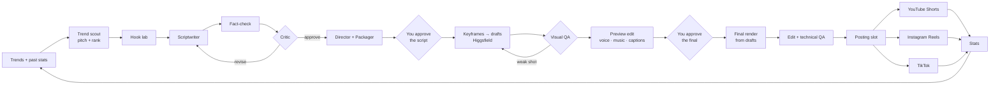

# video-workflow

An automation pipeline for short-form video: **LLM agents write the content, Higgsfield renders
it (through MCP), and the finished vertical videos are published to YouTube Shorts, Instagram
Reels and TikTok, all at the same moment.**

```bash
vw autopilot run # today's video: viral format → script → Higgsfield → QA → posted
vw selftest     # every part working together, offline, in ~15 seconds (no keys, no credits)
vw serve        # the monitoring dashboard: follow every video, every step, live
vw cloud deploy # the same dashboard on Vercel: watch and approve from your phone, anywhere
```

**Live cloud control room:** https://video-workflow-six.vercel.app (password-protected; see
[docs/CLOUD.md](docs/CLOUD.md)).

## What it does

| | |
|---|---|
| **Ideas from what's trending** | Google Trends, Reddit and RSS signals, plus your own videos' stats: the trend scout leans into what works |
| **Any LLM, with fallbacks** | Claude, ChatGPT/GPT, Gemini, OpenRouter/Groq/Ollama, or the Claude Code / Codex / Gemini **CLIs** on a subscription |
| **Better scripts** | Ideas over-generated and ranked; a hook lab writes 5 openings and keeps the strongest; an independent fact-checker and a critic from another model family send drafts back until they're right |
| **Higgsfield via MCP, quality-first** | Keyframe still per shot → animated with image-to-video → cheap 480p draft preview → **you approve** → finals rendered from the drafts. Live price + balance check before any credit is spent |
| **Visual QA** | A vision model inspects frames of every rendered shot and re-renders weak ones automatically — works with no API key through the Claude Code CLI |
| **Production sound + consistency** | Natural narration (ElevenLabs voices via Higgsfield, ≈0.3 credits a line) and an original music track per video (≈3 credits); the first shot's keyframe anchors every other shot so the subject looks the same throughout |
| **Technical QA** | Every cut is checked (resolution, fps, duration, loudness, black/frozen frames, dead air, bitrate, captions, narration pace); failures block publishing |
| **Finished edit** | 1080x1920, narration (OpenAI / ElevenLabs / free offline flite) fitted to each shot, word-by-word captions with a headline, music ducked under the voice, −14 LUFS |
| **Synchronized publishing** | Posting slots per timezone; YouTube + Instagram + TikTok go out in parallel; failed platforms retry alone |
| **You stay in control** | Approve scripts and final renders from **Telegram** (buttons), the **web dashboard**, or the CLI; notifications on Telegram/Slack/Discord/webhook |
| **Monitoring** | Every step, LLM call, render, check and upload is traced: live activity feed, workflow map with per-step health, item timelines, metrics, alerts (stuck items, failures, daemon down, low credits, budget), Prometheus/JSON endpoints, `vw logs -f` |
| **Learns** | Pulls views/likes/comments back from every platform and feeds the winners into the next ideas |
| **Runs itself** | `vw daemon` (or `docker compose up`): daily idea quota → render → publish on schedule → stats → daily digest |
| **Autopilot** | A new video every day with no clicks: viral format → our version → script → Higgsfield → QA → posted to all three platforms. Quality gates stay on, spending is capped, and one ⏸ button (dashboard, Telegram, CLI) stops everything ([docs/AUTOPILOT.md](docs/AUTOPILOT.md)) |
| **Viral scout** | Every day: the best-performing AI-generated shorts (YouTube, TikTok, Reels, Reddit, or links you paste), why each works (hook, format, visual, motion), and our own **original** version of the strongest formats, straight into the pipeline ([docs/VIRAL.md](docs/VIRAL.md)) |
| **Cloud control room** | The dashboard on **Vercel** + Neon Postgres: your worker syncs items, traces, previews and thumbnails; approve, re-render, publish or request ideas from anywhere; the worker picks commands up within ~30 s ([docs/CLOUD.md](docs/CLOUD.md)) |
| **One video, many languages** | The same footage re-voiced, re-captioned and re-packaged per language (e.g. Spanish, Arabic with right-to-left captions); each version gets its own QA score |
| **Content calendar** | An LLM plans a theme per day a week ahead (formats, pillars, timely hooks like anniversaries and meteor showers); the daemon pitches from today's theme and keeps the plan topped up |
| **Source → shorts** | `vw ideas --from-url <article>`: ideas grounded in a page you trust, and the fact-checker checks against it |
| **Publish kit** | One zip per video: every language's video, thumbnail, SRT subtitles, copy per platform, script and an upload checklist, for posting by hand anywhere |
| **Robust** | Parallel workers, SQLite WAL + per-item locks, HTTP retries with backoff, token/credit cost ledger per video |

## How it works



Items move through `idea → reviewed → approved → (awaiting_render) → rendered → edited →
published` (or `rejected` / `failed`). Every step is saved, so the pipeline pauses at any gate
and resumes later. Details: [docs/ARCHITECTURE.md](docs/ARCHITECTURE.md).

## Quick start

```bash
# Python 3.11+ and ffmpeg
uv venv && . .venv/bin/activate
uv pip install -e ".[all,dev]"

vw selftest              # proves the whole system works on this machine
vw init                  # creates config/channel.yaml (your channel brief) and .env (your keys)
vw doctor --live         # tests every configured connection for real (posts nothing)

vw run --ideas 3         # pitch → hooks → script → fact-check → critique → package; stops for you
vw serve                 # dashboard at http://127.0.0.1:8787 — read, watch, approve, monitor
vw run                   # keyframes → drafts → visual QA → preview; approve the final; then
vw run                   # final render → edit → quality gate → publish (on schedule)
```

Always-on, with the Telegram bot:

```bash
vw daemon                # or: docker compose up -d   (daemon + dashboard)
```

### Rendering with Higgsfield inside Claude Code (`handoff`, the default)

1. Open this repo in Claude Code. `.mcp.json` registers the Higgsfield MCP server; run `/mcp`
   once to sign in.
2. Approved items wait in `awaiting_render` (you get a notification).
3. Ask Claude: *"render the pending videos"*. The `higgsfield-render` skill checks the cost,
   generates all shots in one batch, and registers the clips.
4. The daemon (or `vw run`) edits and publishes them.

For unattended runs use `video.generator: higgsfield_mcp` + `HIGGSFIELD_MCP_TOKEN`. See
[docs/HIGGSFIELD.md](docs/HIGGSFIELD.md).

## Commands

| Command | What it does |
|---|---|
| `vw selftest [--full-hd]` | Run every component together offline and report each step (20 checks) |
| `vw cloud deploy [--skip-secrets]` · `vw cloud sync` · `vw cloud status` | Deploy the cloud dashboard to Vercel · push state + apply cloud commands now · check the connection |
| `vw autopilot run\|ready\|status\|pause\|resume` | Fully automatic daily production, its setup checklist and its stop button |
| `vw audio add <id> voice\|music <url>` | Register Higgsfield narration / music (the render skill does this) |
| `vw cloud restore` | Continue on a fresh machine (state, today's spend, rotated tokens) |
| `vw viral [--remix N]` · `vw viral-add <url> [--remix]` | Today's top AI shorts · our own versions of their formats |
| `vw plan --days 7` · `vw localize <id> -l es -l ar` · `vw kit <id>` | Plan the content calendar · build language versions · download the publish kit (zip) |
| `vw logs [id] [-f]` · `vw alerts` · `vw quality <id>` | Step-by-step trace (live with `-f`) · current problems · an item's quality report |
| `vw approve-final <id>` · `vw retry <id>` · `vw rerender <id> -s 2 --note "..."` | Approve the full-res render · resume a failed item · re-shoot chosen shots |
| `vw higgsfield-balance <credits> --plan <plan>` | Record the Higgsfield balance (the render skill does this) |
| `vw init` · `vw doctor [--live]` | Create config files · check (and with `--live`, test) every connection |
| `vw run [--ideas N] [--until stage]` | Push every item as far as the gates allow (parallel workers) |
| `vw daemon [--once]` | Always-on loop + Telegram bot |
| `vw serve` | Monitoring dashboard: board, calendar, activity feed, workflow map, metrics, health, self-test, item pages |
| `vw bot` | Telegram bot only |
| `vw ideas -n 5 -s "black holes"` · `vw ideas --from-url <url>` · `vw trends` | Pitch ideas (from a topic or a source article) · see current trend signals |
| `vw develop <id>` · `vw approve <id>` · `vw reject <id>` | Step through an item by hand |
| `vw render <id> [-g mock\|handoff\|higgsfield_mcp]` · `vw render-request <id>` · `vw clips add <id> <shot> <url>` | Rendering |
| `vw edit <id> [--voiceover file]` | Build the final cut |
| `vw publish <id> [-p youtube] [--now]` | Publish (all platforms in parallel; `--now` skips the slot) |
| `vw stats` · `vw digest [--send]` | Pull platform stats · summary of what needs you, what's scheduled, views and spend |
| `vw list` · `vw show <id>` | Inspect items |
| `vw auth-youtube` | One-time OAuth for YouTube upload + stats |

## Choosing models

```yaml
llm:
  routes:
    scripting: ["anthropic:claude-opus-5-5", "openai:gpt-5.5", "gemini:gemini-3.1-pro-preview"]
    review:    ["openai:gpt-5.5", "anthropic:claude-opus-5-5"]   # cross-model critique
    packaging: ["cli:codex", "openrouter:meta-llama/llama-4-maverick"]
```

Each task tries its candidates in order; an unconfigured provider is skipped and an error falls
through to the next one. Token use is recorded per video and shown in the dashboard.

## Repository layout

```
src/video_workflow/
  agents/        trend scout, viral analyst, scriptwriter, critic, director, packager, translator, planner (+ prompts/*.md)
  llm/           provider-neutral LLM layer, router with fallbacks, usage ledger
  video/         renderers (handoff, higgsfield_mcp, mock) and the ffmpeg editor
  publishers/    youtube.py, instagram.py, tiktok.py (publish + stats)
  pipeline.py    stage machine          daemon.py     always-on loop
  voice.py       narration engines      schedule.py   posting slots
  notify.py      Telegram/Slack/Discord telegram_bot.py approvals from your phone
  trends.py      trend signals          health.py     live connection checks
  trace.py       step-by-step trace log monitor.py    alerts
  quality.py     technical video QA     web/          monitoring dashboard
  cloud/         Vercel app, Postgres store, worker sync, REST deployer
  kit.py         publish kit (zip)      sources.py    ideas from an article
  viral.py       viral scout (sources, AI detection, ranking)
  readiness.py   autopilot setup checklist
  selftest.py    whole-system check
api/index.py     Vercel entry point (vercel.json, requirements.txt)
config/          channel.example.yaml: the brand bible every agent reads
.claude/skills/  higgsfield-render: Claude Code renders shots via Higgsfield MCP
docs/            AUTOPILOT · ARCHITECTURE · SETUP · OPERATIONS · CLOUD · VIRAL · HIGGSFIELD · ROADMAP
```

Coding agents: `AGENTS.md` (Codex and others), `CLAUDE.md` (Claude Code), `GEMINI.md` (Gemini CLI).

## Status

Phases 0–3 are built and tested: 107 tests, plus `vw selftest` (20 end-to-end checks) in CI
and inside the Docker image. The cloud dashboard is live on Vercel. What's next is in [docs/ROADMAP.md](docs/ROADMAP.md); credentials are covered in
[docs/SETUP.md](docs/SETUP.md) and day-to-day running in [docs/OPERATIONS.md](docs/OPERATIONS.md).

## Responsible use

Videos are AI-generated. Keep `publish.ai_disclosure: true`, keep claims factual (the critic
checks this), don't depict real private people, use music you have rights to, and follow each
platform's rules on synthetic media and automated posting.
