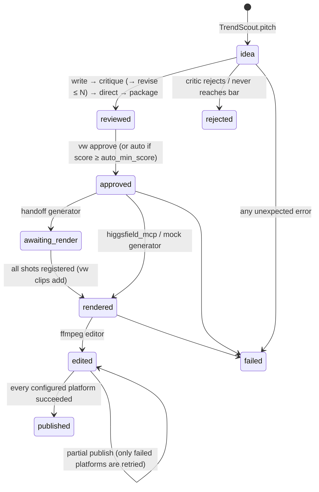
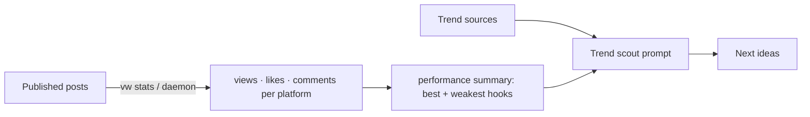

# Architecture

## Design goals

1. **Model-agnostic.** No agent knows which LLM serves it. Swapping Claude for GPT or Gemini
   (or a CLI agent on a subscription) is a config change.
2. **Gates before spend.** LLM tokens are cheap and video credits are not, so scripts are
   critiqued, revised and approved before anything is rendered.
3. **Resumable.** Every step persists the item, so a crash, a missing credential or a human
   gate just pauses the item. Running the step again continues it.
4. **Testable offline.** All network edges (LLMs, MCP, platform APIs, Telegram, trends) are
   injected, so the whole system runs in tests (and `vw selftest`) with fakes and real ffmpeg.
5. **Safe concurrency.** Items are processed in parallel; SQLite runs in WAL mode and each item is
   leased to one worker at a time, across threads and processes.
6. **Humans in the loop, from anywhere.** Every gate notifies you and can be cleared from
   Telegram, the dashboard or the CLI.

## Stage machine



`Pipeline.advance()` loops over these transitions until it reaches a gate (`reviewed`
waiting for approval, `awaiting_render` waiting for clips, a partial publish) or the `--until`
stage.

## Components

| Layer | Module | Responsibility |
|---|---|---|
| Config | `config.py` | `Secrets` from env/.env; `AppConfig` from `config/channel.yaml` |
| State | `models.py`, `store.py` | `ContentItem` with full history, stored as JSON in SQLite |
| LLM | `llm/router.py` | Task → `[provider:model, ...]` with fallback and lazy provider construction |
| | `llm/anthropic_provider.py` | Claude, native structured outputs (`messages.parse`), effort control, server-side refusal fallback |
| | `llm/openai_provider.py` | OpenAI Responses API structured outputs; Chat Completions JSON mode for compatible endpoints |
| | `llm/gemini_provider.py` | Gemini with `response_schema` |
| | `llm/cli_provider.py` | Claude Code / Codex / Gemini CLI over stdin, JSON extracted and validated |
| Agents | `agents/*.py` + `prompts/*.md` | TrendScout, Scriptwriter, Critic, Director, Packager |
| Render | `video/handoff.py` | Writes `render_request.json` for Claude Code + Higgsfield MCP |
| | `video/higgsfield_mcp.py` | Headless MCP client: cost preflight → batch submit → poll → download |
| | `video/mock.py` | Free placeholder clips for testing |
| Voice | `voice.py` | Per-shot narration: OpenAI TTS, ElevenLabs, or offline flite; cached by text hash |
| Edit | `video/editor.py` | Parallel normalise to 1080x1920@30, stitch, fit narration per shot, ASS word captions + headline, music with sidechain ducking, loudnorm −14 LUFS, thumbnail |
| Schedule | `schedule.py` | Next free posting slot per timezone and daily cap; every platform posts together |
| Publish | `publishers/*.py` | YouTube resumable upload; Instagram resumable Reels; TikTok chunked FILE_UPLOAD (draft or direct); `fetch_metrics` on each |
| Network | `net.py` | Retries with backoff and Retry-After; non-idempotent calls never retried after an ambiguous 5xx |
| Trends | `trends.py` | Google Trends RSS, Reddit top posts, any RSS/Atom feed (fail-soft) |
| Notify | `notify.py`, `telegram_bot.py` | Telegram (Approve/Reject buttons), Slack, Discord, webhook; bot commands from the owner chat only |
| Ops | `daemon.py`, `dashboard.py`, `health.py` | Always-on loop with file lock; web UI; live connection checks |
| Proof | `selftest.py`, `testing.py` | Whole-system run with a scripted LLM and simulated platform APIs |
| Entry | `cli.py`, `factory.py` | `vw` commands; wiring from config |

## Agent roles

| Agent | Input | Output schema | Default effort |
|---|---|---|---|
| TrendScout | channel brief, seeds, recent titles | `IdeaBatch` | high |
| Scriptwriter | idea (+ previous draft and review) | `Script` (shots with voiceover and on-screen text) | high |
| Critic | idea + script | `Review` (score, verdict, problems, revision instructions) | high |
| Director | script + visual style | `RenderPlan` (one self-contained video prompt per shot + style anchor) | medium |
| Packager | script | `Packaging` (YouTube title/description/tags, IG and TikTok caption + hashtags) | low |

The Critic's default route starts with a different model family from the writer's, because a
second model catches more problems than the writer reviewing itself.

## Why rendering goes through MCP

Higgsfield exposes its whole catalog (Seedance, Kling, Cinema Studio, MiniMax, audio,
upscaling, TikTok publishing...) through one MCP server. Using MCP means:

- in **Claude Code** the same tools are available to the agent you are already chatting with
  (`handoff` mode). No extra credentials, and you can step in creatively;
- for **headless** runs the pipeline is just another MCP client (`higgsfield_mcp` mode);
- new Higgsfield models show up without code changes: set `video.higgsfield.model`.

## Feedback loop



## Concurrency model

- `Pipeline.run()` advances active items on a thread pool (`runtime.workers`).
- `Pipeline.advance()` takes a lease on the item (`leases` table, 1 h TTL), re-reads the
  freshest copy, then works on it, so the daemon, dashboard, Telegram bot and CLI never
  process the same item at once.
- Within an item: narration clips, segment normalisation and the three platform uploads run
  in parallel.
- The usage ledger binds the item's `Usage` to a context variable per worker thread; providers
  report token counts and the router books them against the item.

## Data on disk

```
data/
  pipeline.sqlite3            items (JSON), leases, kv (Telegram offset, daemon state)
  daemon.lock                 single-daemon file lock
  tiktok.token.json           rotated TikTok tokens (gitignored)
  items/<id>/clips/           shot_00.mp4 ..., render_request.json
  items/<id>/voice/           narration per shot
  items/<id>/edit/            normalised segments, fitted narration, captions.ass, stitched.mp4
  items/<id>/final.mp4        the published file
  items/<id>/thumbnail.jpg
```
