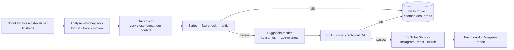

# Autopilot: a new video every day, made and posted without clicks



Turn it on in `config/channel.yaml` (`autopilot.enabled: true`, already on for this channel).

## Safety rails (all on by default)

| Rail | What it does |
|---|---|
| Quality gates | Critic score ≥ `min_script_score` **and** a clean fact-check before any credit is spent; technical QA (and visual QA when a vision model is set) before posting. Anything that fails waits for you; the autopilot tries another idea (`max_attempts_per_day`) |
| Compliance check | Every script, before any credit is spent: copyright (characters, franchises, lyrics, another creator's lines), a real person's likeness, trademarks, harmful claims, community guidelines, realistic fake events, and copying more than the *format* of the viral source. A fixable problem is rewritten once and checked again; anything else (or a check that couldn't run) waits for you. Dashboard → video → 🛡 Compliance (`compliance:` in the config) |
| Spend cap | No render starts if today's Higgsfield spend + its estimate passes `max_credits_per_day`, or if the balance can't cover it. No script is even written that day |
| Stop button | ⏸ **Pause everything** on the dashboard (local or cloud), `/pause` on Telegram, or `vw autopilot pause`. While paused nothing new is made, rendered **or posted**. `/resume` to continue |
| Originality | Remixes keep the format and energy, never the original's footage, audio, characters, names or script, and skip videos built on real people, brands or copyrighted characters. Platforms bury re-uploads and near-copies (YouTube "reused content", TikTok/Instagram "unoriginal content"), so this also protects the account |
| AI labels | `ai_disclosure: true` labels every post as AI-generated where the platform supports it |

## What it makes each day

`autopilot.source: mix` (this channel): the **trend radar** reads today's signals — Wikipedia's
most-read pages and how fast they climbed, Google News science, Google Trends (plus YouTube's
chart with a key) — and Claude turns them into topics scored for the channel (fit × momentum),
each with how long it stays timely and a ready, fact-careful angle. The idea writer then **fuses**
the best topic with a format that is going viral in AI shorts today (from the viral scout). If
no topic fits, it remixes today's strongest viral format instead. Dashboard → **Trends** shows
the radar with a 🎬 Make a video button per topic.

The first choice each day is a **follow-up of one of our own hits** when there is one
([GROWTH.md](GROWTH.md)). A trend video carries its window (`timely_for_hours`): it takes the
earliest posting slot ahead of evergreen videos, posts at once if no slot comes before its window
closes (`publish.schedule.rush_timely`), and you get an alert if it is still waiting for your
approval as the window closes.

## Production quality, built in

| | What | Cost |
|---|---|---|
| One subject across shots | Shot 1's keyframe is drawn first; every other keyframe uses it as a reference image | free (same keyframe price) |
| Natural narration | ElevenLabs voices through Higgsfield (`video.voice.provider: higgsfield`); a missing line is spoken by the offline voice and requested again | ≈0.3 credits per line |
| Original music | An instrumental made for each video (`video.music.generate: true`), ducked under the voice | ≈3.2 credits |
| Visual QA | Every shot is judged on sampled frames; weak shots are re-rendered with a corrected prompt. Works through the Claude CLI, no API key | LLM only |
| Speed | Fact-check and critic run side by side, and so do shot prompts and posting copy (≈30% less waiting per script on real runs) | — |

## Setup checklist

`vw autopilot ready` (also on the dashboard's Health page and as a banner on the board) lists
what the autopilot still needs — Higgsfield connector and credits, writers, viral sources, each
platform's credentials, cloud memory, Telegram — with how to fix each one. Every autopilot run
refreshes it. While credits are short, the autopilot still prepares ONE video (script, fact-check,
shot prompts) so it renders the moment you top up.

## What you need to set up (once)

Create the accounts, then connect them on the **cloud dashboard → Connect** page: paste each key once
(it is encrypted before it is stored and never shown again), and for YouTube press **Connect with
Google**, with no `vw auth-youtube` on a computer. Your worker picks them up at its next sync; the
only variables it needs itself are `VW_CLOUD_URL` and `VW_CLOUD_SECRET`. Values set in the worker's
environment still work, and win over the dashboard (see "Where it runs").

### 1. Higgsfield credits
A 20-second video (4 shots: keyframe + 1080p shot each, narration and music) costs about **332 credits**. A video a
day is ~10,000 credits a month. Top up or pick a plan in Higgsfield; the autopilot reads the
balance before every render.

### 2. YouTube (channel + upload access)
1. Create the YouTube channel with your Google account.
2. console.cloud.google.com → new project → enable **YouTube Data API v3**.
3. OAuth consent screen: External, add your Google account as a test user. Credentials →
   **OAuth client ID → Desktop app**. Note the client id and secret.
4. On a computer with this repo: put `YOUTUBE_CLIENT_ID` / `YOUTUBE_CLIENT_SECRET` in `.env`,
   run `vw auth-youtube`, approve in the browser → it prints `YOUTUBE_REFRESH_TOKEN`.
5. Same project → Credentials → **API key** (restrict to YouTube Data API v3) → `YOUTUBE_API_KEY`
   (this one is for finding viral videos).
6. **Limit:** uploads from an unaudited project are forced to *private*. Apply for the
   **YouTube API Services audit** (Google's "Audit and Quota Extension" form) right away; until it's
   approved, publish each private video from YouTube Studio with one click.

### 3. Instagram (fully automatic from day one)
1. Switch the Instagram account to **Professional** (Creator or Business) and link it to a
   Facebook Page.
2. developers.facebook.com → Create app (type Business) → add **Instagram** → *API setup with
   Facebook login*. Add yourself as admin of the app (development mode is enough for your own account).
3. Graph API Explorer → your app → permissions `instagram_basic`, `instagram_content_publish`,
   `pages_show_list`, `pages_read_engagement` → generate a token → exchange it for a long-lived one →
   `GET /me/accounts` gives the **Page access token** (it does not expire) and
   `GET /<page-id>?fields=instagram_business_account` gives the IG user id.
4. Values: `INSTAGRAM_ACCESS_TOKEN` (the Page token), `INSTAGRAM_USER_ID`,
   `INSTAGRAM_GRAPH_HOST=graph.facebook.com`.
   (With *Instagram Login* instead, set `INSTAGRAM_GRAPH_HOST=graph.instagram.com`; that token lasts
   60 days and the worker refreshes it every week by itself.)

### 4. TikTok
1. developers.tiktok.com → create an app → products **Login Kit** + **Content Posting API**,
   scopes `video.upload`, `video.publish`, `video.list`.
2. Run the OAuth flow once for your account (redirect URI registered on the app) → access +
   refresh tokens. Values: `TIKTOK_CLIENT_KEY`, `TIKTOK_CLIENT_SECRET`, `TIKTOK_ACCESS_TOKEN`,
   `TIKTOK_REFRESH_TOKEN`. The worker refreshes and rotates them (carried between machines in the
   encrypted cloud vault).
3. **Limit:** until TikTok audits the app, API posts can only be private, so this channel uses
   `tiktok.mode: draft`: each video lands in your TikTok inbox and you tap *Post* (10 seconds).
   Apply for the audit; after approval set `mode: direct` and `privacy_level: PUBLIC_TO_EVERYONE`.

### 5. Optional
`APIFY_TOKEN` (TikTok/Instagram trend discovery, paid per run), `TELEGRAM_BOT_TOKEN` +
`TELEGRAM_CHAT_ID` (reports and the `/pause` button on your phone), `OPENAI_API_KEY` /
`ELEVENLABS_API_KEY` (natural narration), `ANTHROPIC_API_KEY` (visual QA of every shot).

## Where it runs

**A. A daily Claude session (no server needed).** A scheduled Claude Code session starts every
day in this repo's cloud environment and follows `.claude/skills/autopilot/SKILL.md`: restore
state from the cloud dashboard → scout → write → render with your Higgsfield connector →
publish → sync. `VW_CLOUD_URL` goes in the environment's variables; `VW_CLOUD_SECRET` goes in as a
**network secret** for the dashboard's host (`Authorization: Bearer`, value from Vercel → project →
Settings → Environment Variables), so it's never stored in plain text: the worker sends a placeholder
and the environment's network proxy puts the real secret in its place, and the dashboard unseals the
accounts you connected for that worker. Without it the run still makes today's script but can't save
it (it says so). Without `YOUTUBE_API_KEY` the session finds viral videos with a web search instead.

**B. Your own always-on computer or server.** `vw daemon` (or `docker compose up -d`) runs the
same autopilot every 15 minutes. Headless rendering needs `HIGGSFIELD_MCP_TOKEN`
(`video.generator: higgsfield_mcp`); with the default `handoff` renderer it stops at
"ready to render" for Claude.

**C. GitHub Actions** (`vw autopilot run --restore` on a schedule) works the same way as B when
API keys (`ANTHROPIC_API_KEY`, `HIGGSFIELD_MCP_TOKEN`, platform credentials) are repository secrets.

All three share one memory through the cloud dashboard (`vw cloud restore` / `sync`), so you can
move between them without repeating videos or losing today's spend.

## Everyday use

```bash
vw autopilot status      # on/paused, today's spend, what's waiting for you
vw autopilot run         # one full cycle now
vw autopilot pause       # stop everything (also: dashboard button, Telegram /pause)
vw autopilot resume
```
