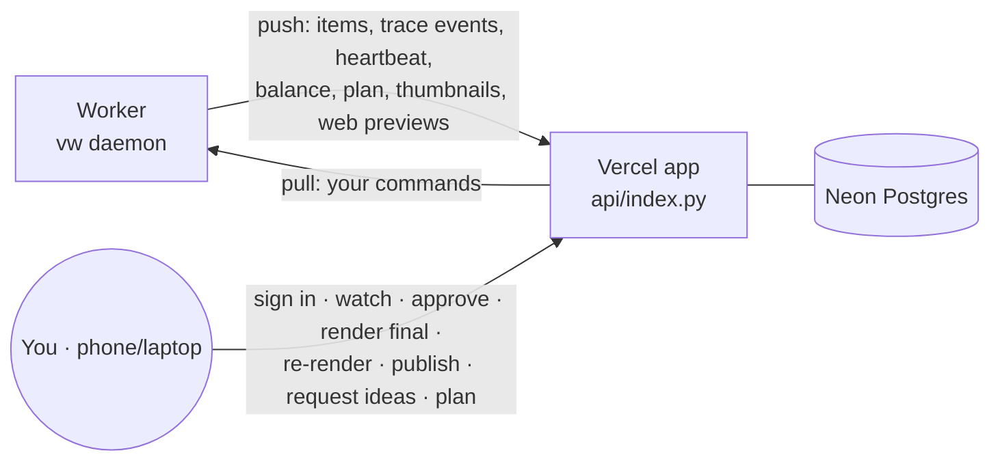

# Cloud control room (Vercel)

Watch and steer the pipeline from anywhere: the full monitoring dashboard runs on Vercel,
backed by a Neon Postgres database. The heavy work (LLM agents, Higgsfield, ffmpeg,
uploads) stays on your **worker**: your computer, a small server, Docker, or GitHub Actions.



The worker never accepts inbound connections. It pushes its state every daemon cycle and
checks for your commands every 30 seconds. Anything you click in the cloud dashboard becomes
a command; the worker applies it and acknowledges it (you see each request's result on the
Health page).

## Live deployment

| | |
|---|---|
| URL | https://video-workflow-six.vercel.app |
| Vercel project | `video-workflow` |
| Database | `video-workflow-db` (Neon, free plan), connected to the project |
| Dashboard password | `DASHBOARD_TOKEN`: Vercel → video-workflow → Settings → Environment Variables (click to reveal) |
| Worker secret | `VW_CLOUD_SECRET`: same place; also in the worker's `.env` |

## Set up a worker

```bash
# on the machine that renders and publishes (has ffmpeg, your keys and Higgsfield)
cat >> .env <<'EOF'
VW_CLOUD_URL=https://video-workflow-six.vercel.app
VW_CLOUD_SECRET=<value from Vercel>
EOF
vw cloud status        # reachable? database + secrets configured?
vw cloud sync          # push once and apply pending commands
vw daemon              # from now on: syncs every cycle, applies commands within ~30 s
```

## Deploy / redeploy

```bash
VERCEL_TOKEN=<token> vw cloud deploy         # first time: creates the project + both secrets
VERCEL_TOKEN=<token> vw cloud deploy --skip-secrets   # later: code only, secrets untouched
```

`vw cloud deploy` uses the Vercel REST API directly: it uploads `api/index.py`, `vercel.json`,
`requirements.txt` and the `video_workflow` package, creates a production deployment and waits
until it's ready. The **Deploy cloud dashboard** GitHub Action does the same on demand (add a
`VERCEL_TOKEN` repository secret).

The database: in Vercel → Storage, create a Neon Postgres database and connect it to the
project (the app reads `POSTGRES_URL` / `DATABASE_URL`). Without one, it falls back to a
temporary SQLite file that is lost between invocations.

## What syncs

| From the worker | Stored as |
|---|---|
| The 150 most recently updated items (full state) | `vw_items` |
| New trace events since the last sync | `vw_events` |
| Daemon heartbeat, Higgsfield balance, health checks, self-test result, content plan, config | `vw_kv` |
| Thumbnails, keyframes, visual-QA frames, and a ~1 MB 640p web preview of every video and language version (40 most recent items) | `vw_media` |

Media and items that disappear from the worker are pruned in the cloud.

## Connected accounts

Dashboard → **Connect** holds the accounts the worker posts with (YouTube, Instagram, TikTok,
Telegram, API keys). Each value is sealed with AES-GCM using a key derived from `VW_CLOUD_SECRET`
before it is stored in Postgres, is never sent back to a browser (ids show their last characters),
and travels to the worker inside the sync response. The worker merges it into its credentials at
startup and after every sync (publishers, notifications, voice and LLM keys are rebuilt); a value
in the worker's own environment always wins. **Connect with Google** runs YouTube's OAuth on the
dashboard (register `https://<your-app>.vercel.app/connect/youtube/callback` as a redirect URI); a
one-time `state` that expires after 15 minutes guards the callback. Only the cloud dashboard edits
connections; a local dashboard shows what its worker has.

## Security

- Every dashboard page and media file needs the password (cookie after sign-in, 30 days,
  `HttpOnly; Secure; SameSite=Lax`).
- The worker API (`/api/cloud/*`) needs `Authorization: Bearer <VW_CLOUD_SECRET>`. A worker in a Claude
  Code cloud environment can hold it as a network secret instead of in `.env`: it then has only
  `VW_CLOUD_URL`, and `/api/cloud/connections` returns the connected accounts already unsealed (only
  with that bearer — whoever holds the secret could open the vault anyway).
- Commands are a fixed list (approve, final, reject, retry, rerender, publish, ideas, plan);
  the worker validates each one against the item's current stage before applying it.
- Platform credentials, LLM keys and Higgsfield never leave the worker.
- `robots.txt` disallows indexing.

## Limits

- Vercel function requests are capped at 4.5 MB, so videos are synced as compact web
  previews; download full-quality files and publish kits from the worker's dashboard.
- Health checks and the self-test run on the worker; the cloud shows their latest results.
