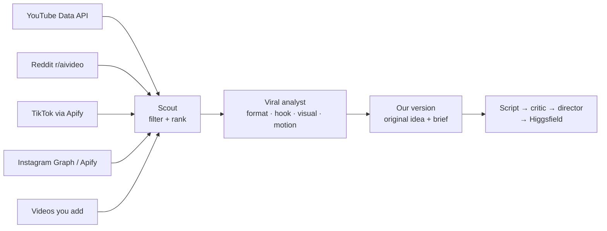

# Viral scout: learn from the best AI videos, make our own

Every day the daemon finds the AI-generated shorts that are performing best right now,
works out **why** each one works, and pitches **our own original version** of the strongest
formats. Those ideas then go through the normal pipeline: hooks → script → fact-check → critic
→ Higgsfield shot prompts → your approval → render → publish.



## What "replicate" means here

We copy the **format**, never the content. The analyst names what makes a video work
(hook pattern, visual mechanic, camera and subject motion, pacing, emotion) and designs a new
video with a different subject, story, characters and script. The prompts tell the writer,
critic and director to keep the energy and reject anything that reuses the original's
script, characters, names, logos, music or exact shots. Videos built on real people,
celebrities, brands or copyrighted characters are skipped. Each of our videos records the
video that inspired it (item page → "Inspired by a viral video").

## Sources

| Source | What it gives | Needs |
|---|---|---|
| `youtube` | Most-viewed recent Shorts for your search queries, with views, likes, comments, duration, thumbnail | `YOUTUBE_API_KEY` (free: Google Cloud console → enable *YouTube Data API v3* → Credentials → API key). About 500 of the 10,000 free daily quota units |
| `reddit` | Top video posts of the day in AI-video communities (r/aivideo) | nothing (Reddit often blocks data-centre IPs; fails soft) |
| `tiktok` | Hashtag results (#aivideo, #veo3 ...) with plays, likes, comments, shares | `APIFY_TOKEN` (Apify actor, paid per run) |
| `instagram` | Top reels for hashtags | Your Instagram Graph credentials (Business account) or `APIFY_TOKEN` |
| you | Any link you paste: `vw viral-add <url>` or the form on the Viral page | nothing; YouTube links get live stats |

TikTok and Instagram have no official API for discovering other people's videos; the Apify
actors collect public data. Check that this fits each platform's terms for your use.

## Ranking

Videos must show AI-generation signals (tools named in the title/description/tags such as
Veo, Kling, Seedance, "AI generated"; or come from an AI-video community/hashtag), be
recent (`lookback_days`), short (`max_duration_s`) and reach `min_views`. The score blends
reach (views), speed (views per hour since posting) and engagement ((likes + 3×comments +
2×shares) / views) on log scales so one giant number can't dominate.

## Use it

```bash
vw viral                         # pull + rank now (table)
vw viral --remix 2               # ... and pitch our versions of the 2 strongest concepts
vw viral --cached -k youtube:abc # remix one specific video from the last pull
vw viral-add https://www.tiktok.com/@x/video/123 --title "what happens" --views 2400000 --remix
```

Dashboard → **Viral**: today's list with stats and thumbnails, the analysis of each video,
**Make our version** per video, **Scout now**, and a box to paste a video you found. It works
the same in the cloud dashboard (the worker runs it).

`config/channel.yaml`:

```yaml
viral:
  enabled: true
  daily_remixes: 1      # our versions per day
  hour: 7               # when the daily scout runs (local time)
  stay_in_niche: false  # true: every concept is adapted to the channel's niche
```

The daily run sends a 🔥 "Today's viral AI videos" notification (Telegram etc.) with the top
three and the idea we made.
